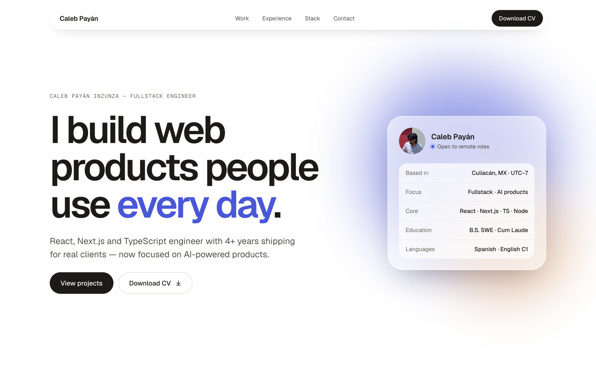
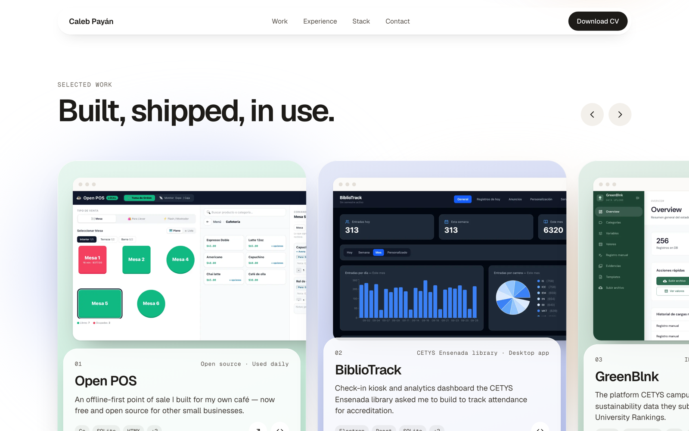

# Caleb Payán — Portfolio

Personal site of **Caleb Payán Inzunza**, Fullstack Engineer (React · Next.js · TypeScript · Node).



## Featured work

| Project | What it is | Stack |
|---|---|---|
| [**Open POS**](https://github.com/Calebpyn/open-pos) | Offline-first point of sale I built for my own café — now free and open source (AGPL-3.0). | Go · SQLite · HTMX · Alpine.js · Swift |
| [**BiblioTrack**](https://github.com/Calebpyn/bibliotrack) | Check-in kiosk and analytics dashboard for the CETYS Ensenada library, used for accreditation reporting. | Electron · React · SQLite · Express |
| **GreenBlnk** | Sustainability data platform for CETYS's INESU and the UI GreenMetric ranking. I led the dev team. *(Private client project.)* | React · TypeScript · Azure Functions · Azure SQL · Power BI |



## Tech

- **Next.js 16** (App Router) and **TypeScript**, statically prerendered
- **Plain CSS** with design tokens: glass surfaces, a scroll-snap carousel and a native `<dialog>` for project details. No UI framework.
- Responsive from 320px, keyboard accessible, respects `prefers-reduced-motion`
- `next/image` for the screenshots, `next/font` (Geist) for type

## Run locally

```bash
pnpm install
pnpm dev
```

Then open http://localhost:3000.

## Structure

```
src/
  app/          layout, page, global styles and favicon
  components/   Nav, Hero, Projects, Experience, Stack, Education, Contact
  content/      profile.ts: every piece of copy on the site
public/
  projects/     project screenshots
  cv.pdf        downloadable CV
```

## Editing content

All copy lives in [`src/content/profile.ts`](src/content/profile.ts): projects, experience, stack, education and links. To re-theme the site, change `--accent` in [`src/app/globals.css`](src/app/globals.css).

The site copy mirrors the CV, so when you replace `public/cv.pdf`, update `profile.ts` too.

Screenshots: Open POS uses the captures from its own repo, and BiblioTrack was captured with a generated demo roster. No real student data is shown.

## Deploy

Works as-is on [Vercel](https://vercel.com/new): import the repo, no configuration needed.
